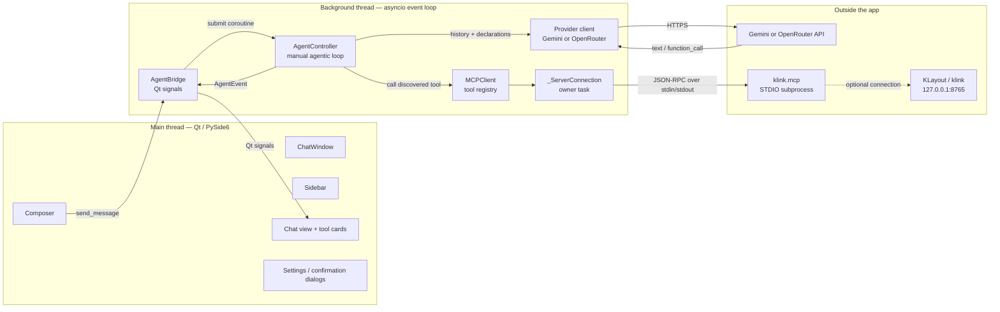

# autodrc

autodrc is a small desktop chatbot that lets a configurable model provider
(Google Gemini or OpenRouter) discover and call tools on local MCP servers. The
UI is built with **PySide6 (Qt 6)** and runs on the desktop as a native
application — no browser or web frontend.

The agent loop, provider adapters, and MCP client live in `app/agent`,
`app/llm`, and `app/mcp_client`. The GUI only talks to the agent through a small
protocol and never imports a provider SDK or the MCP SDK directly.

---

## Installation

Requirements: Python 3.12+, PySide6, and API access to Google Gemini or
OpenRouter.

### Clone the repo

```sh
git clone <repo-url> autodrc
cd autodrc
```

### With `uv` (recommended)

```bash
uv sync
```

### With plain `pip`

```bash
python3.12 -m venv .venv
source .venv/bin/activate
pip install -r requirements.txt
```

PySide6 ships prebuilt Qt wheels for Linux, macOS, and Windows. On minimal Linux
images you may need the usual X11/Wayland client libraries. In particular, Qt
6.5+ requires `libxcb-cursor0` for the X11 (`xcb`) platform plugin:

```bash
sudo apt update
sudo apt install libxcb-cursor0
```

### Configure the model provider

```bash
cp .env.example .env
```

Edit `.env` and choose a provider.

**Google Gemini (default):**

```env
LLM_PROVIDER=gemini
GEMINI_API_KEY=your_real_key
GEMINI_MODEL=gemini-2.5-flash
```

**OpenRouter:**

```env
LLM_PROVIDER=openrouter
OPENROUTER_API_KEY=sk-or-v1-...
OPENROUTER_MODEL=google/gemini-2.5-flash
```

OpenRouter exposes many models behind one API. The chosen model must support
tool calling; models without tool support return an API error that is shown in
the transcript and log.

#### Configuration reference

| Variable | Required | Default | Meaning |
| --- | --- | --- | --- |
| `LLM_PROVIDER` | no | `gemini` | `gemini` or `openrouter` |
| `GEMINI_API_KEY` | when Gemini | — | Google AI Studio API key |
| `GEMINI_MODEL` | when Gemini | — | Gemini model that supports function calling |
| `OPENROUTER_API_KEY` | when OpenRouter | — | Key from https://openrouter.ai/keys |
| `OPENROUTER_MODEL` | when OpenRouter | — | Tool-capable OpenRouter model ID |
| `OPENROUTER_BASE_URL` | no | `https://openrouter.ai/api/v1` | Override the API endpoint |
| `OPENROUTER_SITE_URL` | no | — | Sent as the `HTTP-Referer` attribution header |
| `OPENROUTER_APP_NAME` | no | `autodrc` | Sent as the `X-Title` attribution header |
| `LLM_SYSTEM_INSTRUCTION` | no | built-in | Override the system instruction (falls back to `GEMINI_SYSTEM_INSTRUCTION`) |
| `AGENTS_MD_PATH` | no | `AGENTS.md` | Project instructions appended to the system instruction and re-read on every turn; relative paths resolve against the repo root. `none` disables it |
| `LLM_TEMPERATURE` | no | SDK default | 0.0–2.0; falls back to `GEMINI_TEMPERATURE` / `OPENROUTER_TEMPERATURE` |
| `MAX_TOOL_ITERATIONS` | no | `1000` | Model requests per turn before the GUI asks to continue |
| `MAX_TOOL_RESULT_CHARS` | no | `20000` | Truncate huge MCP results sent to the model |
| `MCP_CONFIRM_TOOL_CALLS` | no | `true` | Initial state of the confirmation checkbox |
| `MCP_CONFIG_PATH` | no | `mcp_servers.json` | Server configuration file |
| `LOG_LEVEL` | no | `INFO` | Python logging level |

The provider and model can also be changed for the current session from
**Settings → Assistant**. Only providers with an API key configured are offered,
and the conversation continues across a switch. `LLM_PROVIDER` still chooses the
provider at startup; the environment file remains the source of truth on the
next launch.

### Configure the MCP server

`mcp_servers.example.json` is the committed template; copy it to
`mcp_servers.json` and adjust the command. `MCPClient` accepts multiple servers:

```json
{
  "servers": {
    "klink": {
      "command": "/home/ig/sky130-env/bin/python",
      "args": ["-m", "klink.mcp"]
    },
    "notes": {
      "command": "/usr/bin/python3",
      "args": ["/home/ig/tools/notes_server.py"],
      "env": {"NOTES_DIR": "/home/ig/notes"},
      "cwd": "/home/ig/tools"
    }
  }
}
```

MCP server entries support:

| Key | Required | Meaning |
| --- | --- | --- |
| `transport` | no | Only `stdio` is implemented |
| `command` | yes | Executable, ideally absolute |
| `args` | no | List of command arguments |
| `env` | no | Extra environment variables merged with the SDK defaults |
| `cwd` | no | Working directory for the server process |
| `connect_timeout` | no | Seconds to wait for initialization |

---

## Run

- with `uv`:

  ```bash
  uv run autodrc
  ```

- with `pip` / an activated virtualenv:

  ```sh
  python -m app.main
  # or
  python app/main.py
  ```

Start KLayout with the klink plugin before asking questions that need live
layout tools. The app still starts and lists tools without it; KLayout-dependent
calls return a server-side connection error, which is shown in the transcript
and passed back to the model.

### GUI overview

- **Sidebar** — conversation history, sorted newest first. Create, select,
  rename, and delete conversations from the list or its context menu. The
  sidebar can be collapsed with `Ctrl+B` and resized with the splitter.
- **Chat area** — distinct user bubbles, assistant Markdown (headings, lists,
  tables, links, blockquotes, inline code, fenced code with syntax
  highlighting), system notices, and inline error cards.
- **Composer** — multiline, auto-growing input. **Enter** sends;
  **Shift+Enter** inserts a newline. Send is disabled while a turn is running;
  its place is taken by a **Stop** button that interrupts the assistant
  (`Esc` as well).
- **Tool activity** — every MCP call appears as a collapsible card showing the
  server, tool, arguments, status (pending/running/completed/failed), and the
  result. Cards can auto-expand from Settings.
- **Status** — the header pill shows Connecting, Ready, Thinking, Running a
  tool, Error, or Offline. MCP connection failures surface as a banner with a
  retry action.
- **Settings** (`Ctrl+,`) — provider, current model, API-key status (never the
  key itself), MCP server list and connection state, tool count, confirmation
  behavior, auto-expand, and the log-file path.
- **Tool confirmation** — enabled by default. A dialog shows the exact tool name
  and arguments before execution; denying the call returns an error response to
  the model instead of executing it.

Conversations are kept in memory for the lifetime of the process. Switching
conversations restores both the GUI transcript and the agent's history
snapshot.

### Keyboard shortcuts

| Shortcut | Action |
| --- | --- |
| `Enter` | Send the message |
| `Shift+Enter` | Insert a newline |
| `Esc` | Stop the running turn |
| `Ctrl+N` | New conversation |
| `Ctrl+B` | Show/hide the sidebar |
| `Ctrl+L` | Focus the composer |
| `Ctrl+,` | Open Settings |

### Logging

Technical details are written to a rotating log file:

```text
${XDG_STATE_HOME:-~/.local/state}/autodrc/app.log
```

User-facing errors are intentionally friendly; the log contains the full
exception and traceback.

---

## Project structure

```text
.
├── app/
│   ├── main.py                 # Qt entry point, logging, startup validation
│   ├── config.py               # environment settings
│   ├── instructions.py         # loads AGENTS.md on every turn
│   ├── agent/
│   │   ├── controller.py       # manual agentic loop
│   │   └── events.py           # GUI-facing event dataclasses
│   ├── llm/
│   │   ├── factory.py          # selects the configured provider
│   │   ├── gemini.py           # native Gemini adapter
│   │   ├── openrouter.py       # OpenRouter (OpenAI-compatible) adapter
│   │   └── schema.py           # provider-neutral tool specs + Gemini schema
│   ├── mcp_client/
│   │   └── client.py           # STDIO connection, discovery, tool calls
│   └── gui/
│       ├── window.py           # main window and application state
│       ├── sidebar.py          # conversation list and status footer
│       ├── chat_view.py        # message widgets, Markdown view, tool cards
│       ├── markdown.py         # safe Markdown renderer and highlighting
│       ├── composer.py         # auto-growing input
│       ├── dialogs.py          # settings, confirmation, startup errors
│       ├── bridge.py           # Qt signals over the asyncio worker thread
│       ├── worker.py           # background asyncio event-loop thread
│       ├── theme.py            # dark palette, fonts, stylesheet
│       ├── icons.py            # painted icons and app logo
│       ├── models.py           # transcript models and AppInfo
│       └── protocol.py         # ChatAgent protocol
├── tests/
├── .env.example
├── mcp_servers.example.json
├── mcp_servers.json            # local config, gitignored
├── requirements.txt
└── pyproject.toml
```

---

## How it works

### Architecture



The GUI never calls a model provider or MCP directly. It only talks to the agent
through `start()`, `send_message()`, `clear()`, `shutdown()`, and the small
snapshot/model helpers. Tool activity arrives as `AgentEvent` objects, which
`AgentBridge` forwards to the Qt main thread as signals. The worker thread owns
the asyncio loop; no blocking call runs on the GUI thread.

The MCP layer has **no provider imports**. The Gemini layer has **no MCP SDK
imports**. The agent is the only place that understands both sides.

### The agentic loop

`AgentController.send_message()` appends the user message, discovers tools, then
repeats up to `MAX_TOOL_ITERATIONS` times:

1. Ask the model with the full history and tool declarations.
2. Append the model turn to history unchanged.
3. If there are no function calls, return the final text.
4. Otherwise validate and execute each call in order, emitting status and tool
   events.
5. Append one user-role turn containing all function responses.
6. Continue until the model answers or the iteration limit is reached.

The limit is a soft budget. When a turn uses up `MAX_TOOL_ITERATIONS` steps
without an answer, the GUI asks **Continue working?** and shows how many steps
were used. Continuing grants another block of the same size (another
`MAX_TOOL_ITERATIONS` requests); stopping ends the turn with an error. The
prompt defaults to **Stop**, so an unattended loop cannot run forever.

Multiple calls in one response run sequentially because tools may have side
effects or depend on each other. Unknown tools, invalid arguments, denied
confirmations, and execution failures all become `{"error": ...}` function
responses, so the model can correct itself or explain the failure.

### Project instructions

`AGENTS.md` in the repository root is appended to the system instruction and is
re-read at the start of every turn. Every conversation therefore runs with the
current rules, edits apply without a restart, and one turn always uses a single
consistent snapshot. A missing file is not an error: the assistant falls back to
the built-in instruction. Use `AGENTS_MD_PATH` to point elsewhere, or set it to
`none` to disable loading.

### Model providers

The controller keeps history in Gemini `types.Content` form as the internal
conversation representation. The native Gemini client sends it directly. The
OpenRouter client translates it to and from OpenAI chat-completions messages on
every request, including tool calls and tool results. MCP JSON Schema is passed
to OpenRouter unchanged; only Gemini needs the schema converter.

### Streaming

Both adapters currently use non-streaming requests. The GUI therefore does
not fake token-by-token output: it shows an animated status pill, live tool
cards, and a disabled composer while a turn is in progress. If streaming is
added to the backends later, the event/bridge layer can forward chunks without
changing the agent or GUI structure.

---

## Tests

```bash
uv run pytest -q
```

The suite covers the agent loop, Gemini/OpenRouter and MCP mocking, schema
conversion, GUI flows (offscreen Qt), Markdown rendering and escaping, history
snapshots, and model changes. Run it with no display available; Qt uses
`QT_QPA_PLATFORM=offscreen`.

Useful checks:

```bash
uvx ruff check app tests
QT_QPA_PLATFORM=offscreen uv run pytest -q
```

An optional live MCP check against the real `klink.mcp` server:

```bash
uv run python - <<'PY'
import asyncio
from app.mcp_client.client import MCPClient, load_server_configs

async def main():
    client = MCPClient(load_server_configs("mcp_servers.json"))
    await client.connect()
    try:
        tools = await client.list_tools()
        print(f"{len(tools)} tools discovered")
        for tool in tools[:10]:
            print("-", tool.name)
    finally:
        await client.close()

asyncio.run(main())
PY
```

---

## Troubleshooting

**`GEMINI_API_KEY is not set` / `OPENROUTER_API_KEY is not set`**
Copy `.env.example` to `.env` and fill in the key for the provider selected by
`LLM_PROVIDER`. Environment variables set in the shell take precedence over
`.env`.

**The provider returns 400/401/403**
Check the key and the model name. The model must support function calling.
With OpenRouter, a 404 usually means the model has no endpoint that supports
tool use. Error text is redacted, but the provider's message is preserved.

**OpenRouter returns 402 or 429**
402 means the account has insufficient credits. 429 means a rate limit was hit;
free models are limited aggressively. Wait, add credits, or choose another
model.

**`Could not start the Qt GUI: no display was detected`**
Run the app in a desktop session, or set `QT_QPA_PLATFORM` (for example
`offscreen` for tests). Check that `DISPLAY` or `WAYLAND_DISPLAY` is set.

**Qt fails to load the platform plugin (`xcb`)**
Install the missing X11 client libraries (commonly `libxcb-cursor0`) or run under
Wayland with `QT_QPA_PLATFORM=wayland`.

**`MCP configuration file not found`**
Set `MCP_CONFIG_PATH` to the correct file, or run from the project directory so
the default `mcp_servers.json` is found.

**`Could not connect to MCP server 'klink'`**
Run the command from `mcp_servers.json` manually in a terminal to see its
startup error. Check that the configured Python exists and that `klink.mcp` is
installed in that environment. Use the banner's retry action after fixing it.

**KLayout connection refused on `127.0.0.1:8765`**
The MCP server is running but KLayout/klink is not. Start KLayout with the klink
plugin. Until then, only tools that do not require the live session will work.

**A tool keeps being called until the iteration limit**
Inspect the tool card in the transcript. The model may be retrying because the
server returned an error. The GUI asks whether to continue when the step budget
runs out; stop there instead of raising `MAX_TOOL_ITERATIONS`, because the limit
is a safety net.

**The tool result is cut off**
`MAX_TOOL_RESULT_CHARS` controls what is sent to the model. Tool cards cap the
displayed result separately.

**Unexpected error dialog**
Open the log file from Settings or the path above; the full traceback is there.

---

## Limitations

- STDIO transport only.
- Non-streaming responses from both providers.
- In-memory conversations; no persistence across launches.
- Tools only; MCP prompts/resources are not exposed.
- The JSON Schema converter supports common keywords, not the entire standard.
- Very large tool sets consume context (the klink server can expose ~196 tools).
- KLayout-dependent tools require a running KLayout/klink session.
- Tool confirmation pauses the agent until the user answers.
