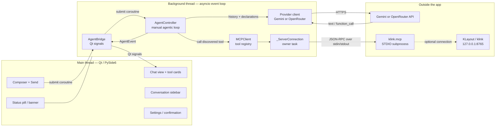

# autodrc

autodrc is a small desktop chatbot that shows how an LLM can **choose and call
tools on a local MCP server**. It uses PySide6 (Qt 6), native Google Gemini
function calling or OpenRouter's OpenAI-compatible API, and the official MCP
Python SDK. There is no agent framework: the loop is implemented directly in
`app/agent/controller.py`.

The configured MCP server is the existing local `klink.mcp` server. Its tools
are discovered at runtime; no tool names or schemas are hardcoded in the
application.

---

## What you get

- A dark, native Qt chat window with a collapsible conversation sidebar,
  distinct user/assistant messages, safe Markdown rendering, and syntax-
  highlighted code blocks.
- An agentic loop: the model can request one or many tools, receive their
  results, and continue until it produces a final answer.
- Selectable model provider: native Google Gemini or OpenRouter (one endpoint
  for many models).
- Live MCP tool discovery over STDIO.
- Collapsible tool activity cards showing server, tool, arguments, state
  (pending/running/completed/failed), and results.
- A confirmation dialog before tool execution (on by default).
- JSON Schema validation of every tool call.
- A responsive GUI: all model/MCP work runs on a background asyncio thread and
  reaches Qt as signals.
- Friendly inline error cards plus a rotating technical log file.
- Clean shutdown of the MCP server process and the model client.
- Unit tests with mocked Gemini/OpenRouter/MCP responses and offscreen Qt GUI
  tests.

---

## Architecture



The GUI never calls a model provider or MCP directly. It only talks to the agent
through `start()`, `send_message()`, `clear()`, `shutdown()`, plus small helpers
to snapshot/restore history and change the model. Tool activity arrives as
`AgentEvent` objects. `AgentBridge` runs on the GUI thread, submits coroutines to
the worker loop, and re-emits worker results as Qt signals, so no Qt widget is
touched from a non-GUI thread. This keeps the GUI replaceable.

The MCP layer has **no provider imports**. The Gemini layer has **no MCP SDK
imports**. The agent is the only place that understands both sides.

---

## Project structure

```text
.
├── app/
│   ├── main.py                 # wiring + entry point
│   ├── config.py               # environment settings
│   ├── agent/
│   │   ├── controller.py       # the manual agentic loop
│   │   └── events.py           # GUI-facing event dataclasses
│   ├── llm/
│   │   ├── factory.py          # selects the configured provider
│   │   ├── gemini.py           # native Gemini adapter
│   │   ├── openrouter.py       # OpenRouter (OpenAI-compatible) adapter
│   │   └── schema.py           # provider-neutral specs + Gemini schema
│   ├── mcp_client/
│   │   └── client.py           # STDIO connection, discovery, tool calls
│   └── gui/
│       ├── window.py           # main window and application state
│       ├── sidebar.py          # conversation list and status footer
│       ├── chat_view.py        # message widgets, Markdown view, tool cards
│       ├── markdown.py         # safe Markdown renderer and highlighting
│       ├── composer.py         # auto-growing input
│       ├── dialogs.py          # settings, confirmation, startup errors
│       ├── bridge.py           # Qt signals over the asyncio worker
│       ├── worker.py           # background asyncio thread
│       ├── theme.py            # dark palette, fonts, stylesheet
│       ├── icons.py            # painted icons and app logo
│       ├── models.py           # transcript models and AppInfo
│       └── protocol.py         # ChatAgent protocol
├── tests/
├── .env.example
├── mcp_servers.example.json
├── mcp_servers.json            # local config, gitignored
├── requirements.txt
└── pyproject.toml
```

---

## What MCP is

The **Model Context Protocol** is a JSON-RPC protocol that lets an AI
application discover and use capabilities exposed by another program. A server
can expose tools, resources, and prompts. This project uses **tools** only.

A typical exchange is:

1. The client starts the server and performs `initialize`.
2. The client calls `tools/list` and receives names, descriptions, and JSON
   input schemas.
3. The model chooses a tool.
4. The client calls `tools/call` with validated arguments.
5. The server returns text, structured content, images, or an error flag.

The MCP SDK handles the wire protocol. This application calls its async client
API (`list_tools`, `call_tool`) and converts the results into plain Python
objects.

---

## The existing MCP server

`mcp_servers.json` is the local, machine-specific configuration. The current
file launches the server you specified over **STDIO**:

```json
{
  "servers": {
    "klink": {
      "transport": "stdio",
      "command": "/home/ig/sky130-env/bin/python",
      "args": ["-m", "klink.mcp"],
      "env": {},
      "cwd": null,
      "connect_timeout": 20
    }
  }
}
```

The actual file is gitignored; `mcp_servers.example.json` is the committed
template. The client launches this command as a subprocess and speaks MCP on
its stdin/stdout.

`klink.mcp` also needs a running KLayout instance with the klink plugin for
most geometry/DRC tools. Without it, the server can still start and list tools,
but those calls return a connection error. That is a server-side condition;
the chatbot reports it and passes the error back to the model.

### Why the connection lives in an owner task

The MCP SDK's `stdio_client()` is an AnyIO context manager. AnyIO cancel scopes
must be exited by the same task that entered them. A GUI application naturally
wants to connect in one task, call tools from another, and close from a third.

To avoid "cancel scope in a different task" errors, `_ServerConnection` creates
one long-lived asyncio task. That task opens the transport, initializes the
session, and processes list/call requests from an `asyncio.Queue`. The public
`MCPClient` API is just an async façade over that queue. Shutdown sends a
sentinel, so the same task closes both context managers cleanly.

Tool discovery is refreshed at the start of every user turn, so a server that
adds tools at runtime is picked up. Connection is all-or-nothing: if one of
several configured servers cannot start, already-started servers are closed and
the error is reported.

---

## How function calling works

The controller keeps conversation history in Gemini `types.Content` form. With
`LLM_PROVIDER=gemini` that history is sent natively:

1. MCP tools are converted into `types.FunctionDeclaration` objects.
2. They are sent as `types.Tool(function_declarations=[...])` with the
   conversation.
3. Gemini returns a model turn containing `types.Part(function_call=...)`
   parts instead of (or alongside) text.
4. The app executes the calls through MCP.
5. The app appends the **entire model turn unchanged**, then appends a
   user-role turn containing a `types.Part(function_response=...)` for every
   call.
6. Gemini receives the updated conversation and either requests more tools or
   returns the final text.

With `LLM_PROVIDER=openrouter`, `OpenRouterClient` translates that same history
on every request:

- user text becomes an OpenAI `user` message;
- a model turn becomes an `assistant` message with `tool_calls`;
- function responses become `tool` messages keyed by `tool_call_id`;
- MCP JSON Schema is sent unchanged as each tool's `parameters`;
- the OpenAI completion is wrapped back into a `types.GenerateContentResponse`
  so the controller loop is identical for both providers.

Two details matter for the native Gemini path:

- `AutomaticFunctionCallingConfig(disable=True)` is set. The SDK must not run
  anything implicitly; execution is visible in this codebase.
- The model turn is stored verbatim. That preserves function-call IDs and
  thought signatures that newer Gemini models expect to see echoed back.

Function responses use:

```python
types.FunctionResponse(
    name="klink_find_tools",          # the name the model used
    response={"result": "..."},        # or {"error": "..."}
)
```

Unknown tools, invalid arguments, denied confirmations, and execution failures
all become `{"error": ...}` function responses. The model can then correct the
call or explain the failure. Nothing is silently swallowed.

---

## The agentic loop

The loop is in `AgentController.send_message()` and has a hard iteration limit
(`MAX_TOOL_ITERATIONS`, default 8):

```text
append the user message to history
discover MCP tools and build provider tool declarations

repeat up to MAX_TOOL_ITERATIONS times:
    ask the model with the full history + declarations
    append the model turn to history

    if there are no function calls:
        return the final text (error if there is also no text)

    for each function call, in order:
        resolve the requested name back to a discovered MCP tool
        reject unknown tools
        parse and validate arguments against the MCP JSON Schema
        ask the user for confirmation, if enabled
        call the tool through MCP
        emit status events and capture the result

    append one user-role turn containing all function responses

if the limit is reached:
    raise IterationLimitError with a clear message
```

Multiple calls in one model response are executed sequentially in the order the
model returned them. Sequential execution is intentional: tools may have
side effects or depend on each other, and the MCP server processes requests on
one connection.

Conversation history is a list of `types.Content`. It spans user turns across
multiple `send_message()` calls, so the assistant remembers earlier messages
and earlier tool results.

---

## Schema conversion

MCP servers describe arguments with JSON Schema. Gemini uses a smaller
`types.Schema` message. `app/llm/schema.py` performs the mapping explicitly.

Example MCP schema:

```json
{
  "type": "object",
  "properties": {
    "layer": {"type": "string"},
    "count": {"type": "integer", "minimum": 1, "maximum": 10}
  },
  "required": ["layer"],
  "additionalProperties": false
}
```

Becomes, conceptually:

```python
types.Schema(
    type=types.Type.OBJECT,
    properties={
        "layer": types.Schema(type=types.Type.STRING),
        "count": types.Schema(type=types.Type.INTEGER, minimum=1, maximum=10),
    },
    required=["layer"],
)
```

Handled conversions include:

- JSON types: string, number, integer, boolean, array, object.
- Nested objects, arrays, and `required`.
- `additionalProperties` is kept in the source schema for validation but is
  omitted from the Gemini declaration: Gemini's REST API rejects that field
  even though the Python `Schema` model exposes it.
- Arrays without `items` (common in the klink schemas) receive a permissive
  union item schema. Gemini requires `items`, while JSON Schema does not.
- `minimum`/`maximum`, string length, item/property counts, and `pattern`.
- String enums. Numeric enums are described in text because Gemini's `enum`
  field only accepts strings.
- Nullable types: `{"type": ["string", "null"]}` or `anyOf` with `null`
  becomes `nullable=True`.
- `$ref`/`$defs`/`allOf` are resolved locally. Recursive schemas are cut off
  with a clear description rather than recursing forever.
- Unions become Gemini `any_of`.

Gemini function names have their own rules. MCP names such as
`klink.find_tools` are sanitized to `klink_find_tools`, and a bidirectional map
lets the agent execute the original MCP tool. If two servers expose colliding
names, the function name is made unique deterministically.

The raw JSON Schema from the server is still used for **validation** before
execution, so sanitization never weakens argument checks.

---

### Adding another transport

Only STDIO is implemented. To add Streamable HTTP or SSE:

1. Add a transport discriminator and URL/headers to `MCPServerConfig`.
2. In `_ServerConnection._run()`, choose the matching MCP SDK context manager
   (`streamablehttp_client` or `sse_client`) instead of `stdio_client`.
3. Keep the owner-task pattern so the transport is entered and exited by the
   same task.

The rest of the app does not need to change.

---

## Security notes

- **Credentials stay in the environment.** `.env` is gitignored. The GUI and
  logs never print the key. Gemini and OpenRouter API error text is redacted
  before it reaches the user.
- **Only discovered tools can run.** The model's requested name is resolved
  through the `ToolSet` built from the current MCP discovery results. An
  invented name is rejected and returned to the model as an error.
- **Arguments are validated** with `jsonschema` against the original MCP input
  schema before any call.
- **No arbitrary code or shell execution.** There is no `eval`, `exec`, or
  shell invocation of model output. The only subprocess is the MCP server
  command from your local configuration.
- **No implicit SDK function calling.** It is explicitly disabled; every tool
  call goes through the code in `AgentController`.
- **Confirmation is on by default**, because MCP tool semantics are external
  and unknown. This treats every tool as potentially sensitive. You can turn it
  off per session with the checkbox or set `MCP_CONFIRM_TOOL_CALLS=false`.
- **Tool descriptions and results are treated as untrusted data.** The system
  instruction says not to follow instructions found inside them, and the GUI
  visually separates tool output from assistant text.
- **Large results are truncated** before being sent to the model, limiting
  context flooding.

There is no automatic approval of destructive operations. If a server exposes
a destructive tool, the user sees and must approve the call by default.

---

## Tests

```bash
uv run pytest -q
```

The suite covers:

| Requirement | Test |
| --- | --- |
| Normal conversation, no tools | `test_normal_conversation_without_tools` |
| Single tool invocation | `test_single_tool_invocation` |
| Sequential tool invocations | `test_multiple_sequential_tool_invocations` |
| Multiple calls in one response | `test_multiple_function_calls_in_one_response` |
| Tool execution failure | `test_tool_execution_failure_is_returned_to_gemini` |
| Unavailable MCP server | `test_unavailable_server_raises_connection_error`, `test_unavailable_mcp_server_fails_cleanly` |
| Iteration limit | `test_iteration_limit_is_enforced` |
| Context across messages | `test_conversation_context_preserved_across_messages` |
| History snapshot / restore | `test_history_snapshot_can_be_restored` |
| Model switching | `test_model_can_be_changed_between_requests` |
| GUI turn + tool activity | `test_window_connects_and_runs_a_turn_with_tool_activity` |
| GUI conversation switching | `test_new_chat_and_restore_preserve_transcript` |
| GUI error handling | `test_turn_failure_is_shown_inline_without_crashing` |
| Schema conversion | `tests/test_schema_conversion.py` |
| OpenRouter translation and errors | `tests/test_openrouter_client.py` |
| Provider configuration | `tests/test_config.py` |
| Markdown rendering and escaping | `tests/test_markdown.py` |
| Unknown/invalid/malformed calls | agent tests |
| Confirmation denial | `test_user_can_deny_a_tool_call` |

MCP and model providers are mocked in the agent/client tests. GUI tests use a
fake agent with offscreen Qt, so they run without a display. No dummy MCP server
is created for the test suite.

The optional live check against the real `klink.mcp` server is:

```bash
uv run python - <<'PY'
import asyncio
from app.mcp_client.client import MCPClient, load_server_configs

async def main():
    client = MCPClient(load_server_configs("mcp_servers.json"))
    await client.connect()
    try:
        tools = await client.list_tools()
        print(f"{len(tools)} tools discovered")
        for tool in tools[:10]:
            print("-", tool.name)
    finally:
        await client.close()

asyncio.run(main())
PY
```

This was verified locally. Tool counts depend on server state: 68 tools were
discovered while KLayout was unavailable, and 196 tools once a klink-enabled
KLayout session was running. A read-only discovery tool executed successfully.

A live Gemini test was also run: Gemini received the discovered declarations,
selected `klink.find_tools`, the agent validated and executed it through MCP,
returned the result, and Gemini produced a final answer. The API exposed two
schema details that unit mocks cannot catch (the rejected
`additionalProperties` field and the required `items` for arrays); both are
handled by the converter and covered by regression tests.

---

## Troubleshooting

**`GEMINI_API_KEY is not set` / `OPENROUTER_API_KEY is not set`**  
Copy `.env.example` to `.env` and fill in the key for the provider selected by
`LLM_PROVIDER`. Environment variables set in the shell take precedence over
`.env`.

**The provider returns 400/401/403**  
Check the key and the model name. The model must support function calling.
Error text is redacted, but the provider's message is preserved. With
OpenRouter, 402 means insufficient credits and 429 means a rate limit.

**`MCP configuration file not found`**  
Set `MCP_CONFIG_PATH` to the correct file, or run from the project directory so
the default `mcp_servers.json` is found.

**`Could not connect to MCP server 'klink'`**  
Run the command from `mcp_servers.json` manually in a terminal to see its
startup error. Check that `/home/ig/sky130-env/bin/python` exists and that
`klink.mcp` is installed in that environment.

**KLayout connection refused on `127.0.0.1:8765`**  
The MCP server is running but KLayout/klink is not. Start KLayout with the klink
plugin. Until then, only tools that do not require the live session will work.

**`Could not start the Qt GUI: no display was detected`**
Run the application in a desktop session, or set `QT_QPA_PLATFORM`. Check that
`DISPLAY` or `WAYLAND_DISPLAY` is set.

**Qt cannot load the `xcb` platform plugin**
Install the missing X11 client libraries. On Ubuntu/Debian, Qt 6.5+ specifically
needs:

```bash
sudo apt install libxcb-cursor0
```

Alternatively, run under Wayland with `QT_QPA_PLATFORM=wayland`.

**A tool keeps being called until the iteration limit**  
Inspect the tool result in the transcript. Gemini may be retrying because the
server returned an error. Increase `MAX_TOOL_ITERATIONS` only after
understanding the loop; the limit is a safety net.

**The tool result is cut off**  
`MAX_TOOL_RESULT_CHARS` controls what is sent to Gemini. The GUI independently
caps display at 8,000 characters per result.

---

## Design notes for learning

- **No agent framework.** The loop, history, function-call parsing, and
  function-response formatting are all visible in one file.
- **Explicit schema conversion.** MCP and Gemini do not use identical schema
  formats; the translation is deliberate and tested rather than magical.
  OpenRouter accepts MCP JSON Schema directly, so it skips that converter.
- **Provider boundary.** The MCP client returns `MCPTool` and `ToolResult`
  dataclasses. Provider clients map those to declarations and API calls.
- **GUI boundary.** The GUI knows only the `ChatAgent` protocol and event
  dataclasses. It does not import `google-genai` or the MCP SDK.
- **Thread boundary.** Qt widgets live on the main thread. `AgentBridge` submits
  coroutines to the asyncio worker and re-emits results as Qt signals; widget
  updates never happen from the worker thread.
- **No hidden execution.** `AutomaticFunctionCallingConfig(disable=True)` and
  the explicit tool registry make the agentic loop auditable.

### Known limitations

- STDIO transport only.
- Non-streaming responses; the UI shows progress but not token-by-token text.
- In-memory conversations with no persistence across launches.
- Tools only; MCP prompts/resources are not exposed.
- The JSON Schema converter supports common keywords, not the entire standard.
- Very large tool sets consume context. The server exposes 196 tools when
  KLayout is connected, producing roughly 200 KB of declarations. This works
  with current models, but it is a real token/request-size cost.
- KLayout-dependent tools require a running KLayout/klink session.
- Confirmation pauses the agent until the user answers (five-minute timeout).
